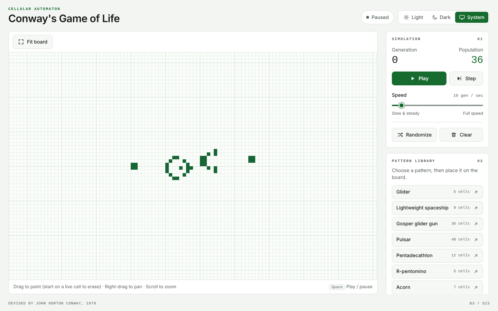
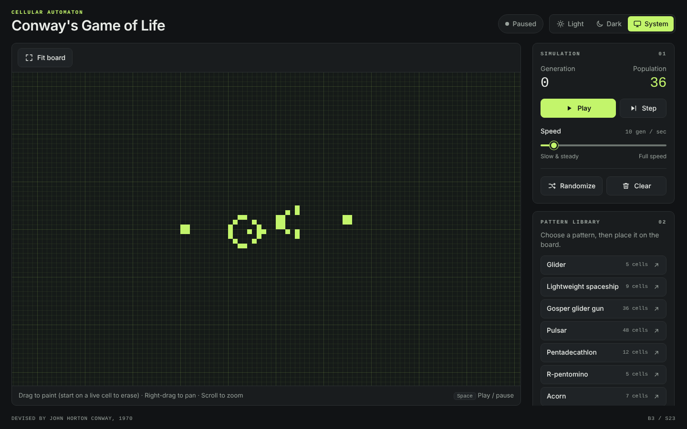

# Conway's Game of Life

A fast, crisp, touch-friendly Game of Life in vanilla JavaScript — native ES modules, no framework, no build step, no runtime dependencies.

**Play it:** https://adisakshya.github.io/conways-game-of-life/

| Light | Dark |
| --- | --- |
|  |  |

## Features

- 256×160 toroidal board (edges wrap) running B3/S23 at 1–120 generations per second
- Pixel-perfect rendering at any `devicePixelRatio`, with 1-device-pixel gridlines
- Gap-free painting with mouse, pen or touch; strokes that start on a live cell erase
- Eight classic presets with a ghost preview, rotation and touch placement
- Wheel, trackpad and pinch zoom; drag panning; fit-to-screen
- A canvas-and-sidebar workspace that stacks on phones, with Play and Step pinned to the bottom edge
- Light and dark themes with a Light / Dark / System switch that remembers your choice
- Keyboard shortcuts and screen-reader stats

## Controls

| Action | Mouse / touch | Keyboard |
| --- | --- | --- |
| Play / pause | Play button (unavailable while a stroke or pattern placement is in progress) | <kbd>Space</kbd> |
| Step one generation | Step button | <kbd>N</kbd> or <kbd>→</kbd> |
| Draw / erase | Drag on the board (starting on a live cell erases). Editing pauses a running simulation and leaves it paused; press Play to resume. | — |
| Clear | Clear button | <kbd>C</kbd> |
| Randomize (25%) | Randomize button: pauses, replaces the board and resets the generation to 0 | — |
| Speed | Speed slider (1–120 gen/s) | Arrow keys on the slider |
| Place a pattern | Pick one in the **Pattern library**, then click the board — or drag and release on touch | — |
| Rotate pattern | Toast **Rotate** button | <kbd>R</kbd> |
| Cancel | Toast **Cancel** button | <kbd>Esc</kbd> reverts the stroke in progress exactly, or cancels a pattern being placed; with nothing to cancel it pauses |
| Zoom | Mouse wheel / trackpad / two-finger pinch | <kbd>+</kbd> / <kbd>−</kbd> |
| Pan | Right-drag, middle-drag, <kbd>Shift</kbd>-drag, or two-finger drag | — |
| Fit board to screen | **Fit board** button | <kbd>F</kbd> |
| Theme | **Light / Dark / System** switch in the header. System follows your OS until you choose Light or Dark; your choice is kept in this browser. | Arrow keys inside the switch |

## Run locally

ES modules do not load from `file://`, so serve the folder over HTTP:

```sh
python3 -m http.server 8000
# then open http://localhost:8000/
```

Run the tests (Node 20 or later, no install needed):

```sh
node --test
```

## Architecture

```
index.html         Markup: header with theme switch, board panel, sidebar cards, stamp toast, live region
styles.css         Layout and design tokens (light + dark via data-theme), canvas colors as CSS variables
src/engine.js      Pure simulation: Uint8Array double buffers, B3/S23 on a torus, frame Clock
src/patterns.js    Pure preset data, plaintext/RLE parsing, 90° rotation
src/renderer.js    Canvas drawing: device-pixel sizing, offscreen cell layer, gridlines, overlays
src/session.js     Play state and the rules for when the board may change (pause-on-edit)
src/input.js       Pointer painting (coalesced events + Bresenham), stamping, wheel/pan/pinch
src/theme.js       Theme preference (system / light / dark), persistence, canvas palette reading
src/ui.js          Sidebar, status, pattern library, stamp toast, keyboard shortcuts
src/main.js        Wiring and the requestAnimationFrame loop
test/*.test.js     node:test suites for engine, patterns, renderer math, input math, theme contrast
```

Data flows one way: `input` and `ui` mutate the `Engine` or the `Renderer` view; every frame `main` advances the `Clock`, steps the engine, and asks the renderer to draw. The renderer skips frames when neither `engine.version` nor the view changed.

Design notes:

- **Crispness.** Cell size is a whole number of device pixels chosen from fixed zoom levels, and the pan offset is rounded once per frame, so every line derives from one integer origin. Cells are written one pixel each to an offscreen canvas and scaled up with `imageSmoothingEnabled = false`, drawing only the visible range.
- **Theming.** An inline script in `index.html` sets `data-theme` before first paint, from the saved choice or else the OS. `src/theme.js` keeps it current and re-reads the canvas palette from CSS variables whenever it changes, so the board re-themes even while paused.
- **Editing.** Painting a stroke or arming a pattern pauses the simulation before anything changes and never resumes it. Play and Step stay unavailable until the edit ends, so a stroke is applied to a board that is standing still and Esc can restore it exactly.
- **Timing.** The simulation is driven by `requestAnimationFrame` (never `setInterval`) with at most 10 steps per frame, so background tabs stay throttled.
- **Deployment.** `.github/workflows/pages.yml` publishes the site files to GitHub Pages on every push to `master`. All asset paths are relative so the site works under `/conways-game-of-life/`.

## License

[MIT](LICENSE)
